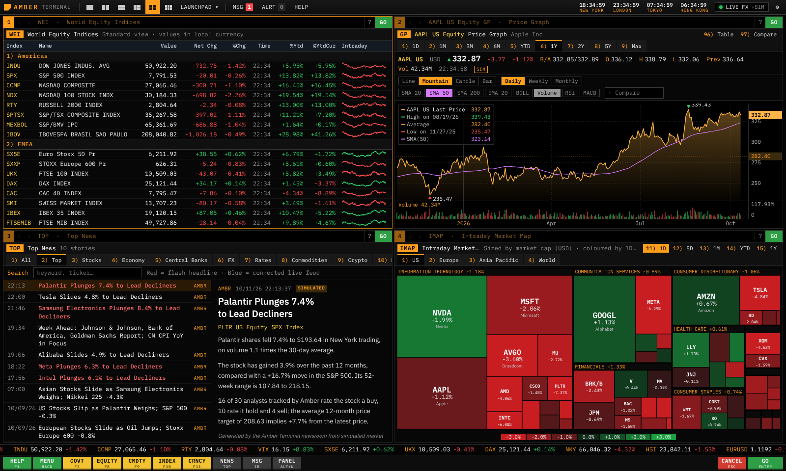
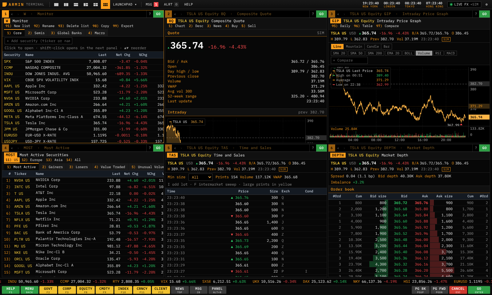
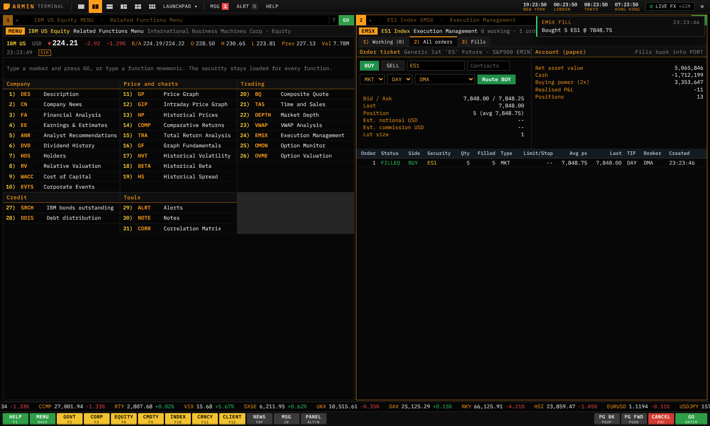

# Armin Terminal

Armin Terminal is a Bloomberg-style market terminal for the browser and the Windows desktop. It copies the way the Bloomberg Professional terminal is driven: amber-on-black screens, a command line where you type a ticker, a yellow market sector key and a function mnemonic, numbered menus you pick with `3 <GO>`, the F1 to F12 sector keys, and up to six independent panels. It has 67 functions covering equities, charts, news, FX, rates, credit, commodities, index futures, economics, options, swaps, paper trading, portfolios, alerts, chat and data provider status.

The Windows desktop app runs on real data only, from free public sources: streaming prices, ten years of history, intraday bars, company financials, estimates, analyst ratings, holders, dividends, listed options and headlines from Yahoo Finance; government bond yields from the US Treasury and the central banks and finance ministries of Germany, the UK, Japan, Canada and Australia; policy rates, funding rates and meeting calendars from the Fed and six other central banks; UK and euro area statistics from the ONS and Eurostat; and US economic releases from the FRED API once you add your free FRED key. Its simulator is switched off. Anything those sources do not cover is left out or the screen says it is not available, instead of showing an invented number. `PROV` lists every provider, its state and the terms that apply; [docs/data-providers.md](docs/data-providers.md) has the details, checked against each provider's own pages.

The browser version has no data source. It opens on a page that says so, and runs a demo only if you choose it: a simulated market in which every value says DEMO DATA.



## Download for Windows

Download the latest version from the [Releases page](https://github.com/arminshah/bloomberg-terminal/releases) (sign in to GitHub first: the repository is private). Each release has two files:

- `Armin-Terminal-Setup-<version>.exe` installs the app with Start menu and desktop shortcuts. Installing a newer version over an older one keeps your watchlists, settings and saved keys.
- `Armin-Terminal-<version>-Portable.exe` runs without installing.

Every push also builds the app in CI: open the [Actions tab](https://github.com/arminshah/bloomberg-terminal/actions), pick the latest successful CI run, and download `armin-terminal-windows` under Artifacts.

The executables are not code-signed, so the first launch may show "Windows protected your PC". Choose More info, then Run anyway.

This is the version with real market and company data (see [Where the data comes from](#where-the-data-comes-from)). It needs an internet connection; without one it shows no prices rather than simulated ones. Open `PROV <GO>` to see each data provider and to add your keys (see [Provider keys](#provider-keys)).

The desktop app has no menu bar, so every F-key reaches the terminal. Window commands use Ctrl+Shift: Ctrl+Shift+N opens another terminal window with its own panel layout, Ctrl+Shift+F toggles full screen, Ctrl+Shift+I opens developer tools, and Ctrl+plus, Ctrl+minus and Ctrl+0 zoom. Watchlists, the portfolio, orders, alerts and settings are shared and stay in sync across windows. Each window remembers its size and position.

A release is published by CI: when a push raises the version in `package.json` and the tests and the Windows build pass, the `release` job in `.github/workflows/ci.yml` creates the GitHub Release for that version with both files. Pushing a tag such as `v1.2.1` also works, through `.github/workflows/release.yml`. Locally, `npm run desktop` starts the desktop app and `npm run desktop:build` writes the installers to `release/` (on Windows; building the installer on Linux needs Wine).

## Provider keys

Most sources need no key. These do, and each is optional:

| Key | What it enables | Where to get it |
| --- | --- | --- |
| `FRED_API_KEY` | US economic releases in `ECO`, US, Japan, Canada and Australia figures in `ECST` | Free from [fredaccount.stlouisfed.org](https://fredaccount.stlouisfed.org). The app uses FRED API version 1, which takes the key as the `api_key` parameter. |
| `MASSIVE_API_KEY` | US end-of-day history from Massive (planned, not used yet) | Free Stocks Basic plan at [massive.com](https://massive.com/pricing?product=stocks) |
| `SEC_USER_AGENT` | SEC filings (planned, not used yet). The SEC asks every client to give a name and a contact email it can reach. | Your own, for example `Armin Terminal your-address@your-domain` |

Enter them in `PROV`, where they are encrypted with your system's key store, or set them as environment variables of the same name (they take precedence). When running from source, a `.env` file copied from `.env.example` works too; it is ignored by git. The keys stay in the desktop app's main process: no screen can read them back, and they are never sent anywhere but to their own provider.

## Run the browser demo

You need Node.js 20 or newer.

```bash
npm install
npm run dev
```

Then open http://localhost:5173. The page says the browser version has no data source; choose Open the demo to start it, or open http://localhost:5173/?demo=1. It is meant for trying the interface on your own machine.

## Using the terminal

Type anywhere and the text goes to the active panel's command line. The syntax follows the Bloomberg pattern of security, yellow key, function, GO:

| Command | What it does |
| --- | --- |
| `IBM US <EQUITY> <GO>` | Loads IBM and shows its related functions menu, numbered by category |
| `AAPL US <EQUITY> GP <GO>` | Price graph for Apple |
| `NVDA DES` | Ticker shorthand plus a function |
| `$APLD` | Cashtags work too |
| `SOFI US <EQUITY> <GO>` | Any US-listed stock; looked up online if it is not built in (see below) |
| `EQUITY <GO>` | Market sector menu for equities (works for every yellow key) |
| `AAPL <CORP> <GO>` | Apple's bonds outstanding |
| `CT10 <GOVT> YAS` | Yield analysis on the current 10-year Treasury |
| `ES1 <INDEX> DES` | S&P 500 E-mini front contract: expiry, basis and fair value |
| `EURUSD <CRNCY> FRD` | Forward points for EUR-USD |
| `GP` | Price graph for the security already loaded in the panel |
| `3 <GO>` | Pick numbered item 3) on the current screen |
| `GP?` | Help on a function |
| `HELP HELP` | Message the help desk (pressing F1 twice does the same) |

Aliases work too: `gold`, `brent`, `bund`, `btc`, `tsmc` and similar names resolve to the right security, and suggestions appear as you type.

Keys follow the Bloomberg keyboard. Enter is GO, Esc is CANCEL, Backspace on an empty line is MENU (back one screen), and PgUp and PgDn page through long screens. F1 is HELP. F2 to F12 are the yellow sector keys GOVT, CORP, MTGE, M-MKT, MUNI, PFD, EQUITY, CMDTY, INDEX, CRNCY and CLIENT; CLIENT opens the portfolio. Mortgages, money market instruments, municipals and preferreds are not covered, and their keys say so and point to related screens. Alt+1 to Alt+6 switch panels and Alt+Left/Right move through history. The key bar at the bottom has the main keys for mouse and touch.

The layout buttons in the top bar switch between one, two, three, four and six panels, and the dividers between panels can be dragged (double-click one to reset). LAUNCHPAD applies preset workspaces such as Trading Desk or Macro & Rates. Clicking a security opens it in the same panel; shift-click opens it in the next one. On a phone the panels become tabs.



## Functions

| Area | Functions |
| --- | --- |
| Menus | `MENU` related functions for the loaded security, market sector menus and the main menu |
| Equity | `DES` description, `FA` financial statements and ratios, `GF` graph fundamentals, `ANR` analyst recommendations, `EE` earnings and estimates, `DVD` dividends, `HDS` holders, `RV` relative valuation, `EVTS` earnings and ex-dividend calendar, `WACC` cost of capital |
| Charts | `GP` price graph with studies and comparisons, `GIP` intraday, `HP` price history table, `COMP` comparative returns, `TRA` total return with dividends reinvested, `HS` spread and ratio analysis, `BETA` regression beta, `HVT` historical volatility |
| News | `TOP` top news (`TOP TECH` for one topic), `N` news search, `CN` company news, `READ` most read stories |
| Markets | `WEI` world equity indices, `WEIF` world index futures, `MOV` index movers, `IMAP` sector heat map, `MOST` most active, `EQS` equity screener, `BQ` composite quote with buy and sell buttons, `TAS` time and sales, `DEPTH` order book, `VWAP` intraday VWAP |
| Trading | `EMSX` order ticket, working orders, fills and cancels; fills book into `PORT` |
| FX and crypto | `FXC` cross rates, `WCRS` currency ranker, `FRD` forward rates, `OVML` FX option pricer, `CRYP` crypto monitor |
| Rates and credit | `WB` world bond yields, `GC` yield curves, `BTMM` Treasury and money markets, `YAS` bond calculator, `WIRP` implied rate path, `CENB` central bank monitor, `SWPM` SOFR swap valuation, `SRCH` fixed income search, `DDIS` debt distribution, `ALLQ` dealer quote montage |
| Commodities | `GLCO` global commodities |
| Economics | `ECO` economic calendar with live releases, `ECST` world economic statistics, `CDR` exchange holiday calendars |
| Derivatives | `OMON` option chain, `OVME` option valuation |
| Tools | `W` watchlists, `PORT` portfolio, performance and risk, `ALRT` price and news keyword alerts, `CORR` correlation matrix, `NOTE` notes, `SECF` security finder, `LAST` recent history, `LPAD` workspaces |
| Communication and system | `IB` chat with a help-desk bot (and simulated trading desks in the browser), `HELP` function directory, `PROV` data providers with their state, terms and keys, `PDFU` settings |



EMSX is paper trading: orders never leave your machine, and in the desktop app they fill against real prices while the market is open (an order entered after the close waits for the next session). Market orders fill at the bid or offer, limit orders rest until the market reaches them, stop orders trigger on the last price, DAY orders expire at the end of the UTC day, and algorithmic brokers slice large orders. Stocks and crypto settle against cash at the full price. Index and commodity futures are margined: fills only move cash by commission and realised P&L, and PORT counts them at unrealised P&L while showing their full notional as exposure. Gross exposure is capped at twice net asset value.

Tables can be copied or exported as CSV. Watchlists, the portfolio, orders, alerts, notes, chats, panel layouts and settings are saved locally.

## Any US stock

The built-in universe covers the large caps, but you can type any US-listed stock, with or without a `$`. If the ticker is not built in, the terminal looks it up online, adds it, and runs your command:

The desktop app asks Yahoo Finance through its own process, so no key is needed. The stock then gets the same real data as the built-in ones: ten years of daily prices, streaming and polled quotes, one-minute intraday bars, and the company's statements, estimates, ratings and holders. Figures Yahoo does not give for it are shown as missing, never filled in. The browser demo does not look stocks up.

`SECF` searches all US stocks by name as well (click Search all US stocks). Looked-up stocks are remembered. Funds, ETFs and non-US listings are not looked up; the terminal says so.

## Where the data comes from

The universe holds 84 stocks across the US, Europe and Asia, 28 equity indices, 11 equity index futures, 23 currency pairs and the dollar index, 19 commodity futures, 32 government yields, 10 cryptocurrencies, the seven on-the-run US Treasuries and 42 corporate bonds from 20 large US issuers. Any other US stock can be added by typing its ticker.

### Desktop app: real data only

The desktop app shows real data and nothing else. A line or screen with no free real source is left out, or says the data is not available, instead of being filled in by the simulator. Everything is fetched through the app's own process, which also keeps any keys. The top bar shows CONNECTED · STREAMING once prices stream, and `PROV` lists every provider with its state, last answer, last problem, requests per minute and the terms that apply.

| Data | Source | Screens |
| --- | --- | --- |
| Streaming prices for stocks, ETFs, indices, US index futures, commodities, currencies and crypto, checked against a quote poll every 30 seconds (every 10 seconds when the stream is down) | Yahoo Finance | Every price screen |
| Daily history (10 years), one-minute intraday bars, dividends and splits | Yahoo Finance | `GP`, `GIP`, `HP`, `BQ`, `W`, `WEI`, `IMAP`, `DVD` |
| Financial statements, estimates, earnings dates and surprises, analyst ratings and price targets by firm, institutional and fund holders, company profile and key ratios | Yahoo Finance | `DES`, `FA`, `GF`, `EE`, `ANR`, `HDS`, `RV`, `EQS`, `EVTS`, `WACC` |
| Listed option chains: expiries, strikes, bid, offer, last, volume, open interest and implied volatility | Yahoo Finance | `OMON`, `HVT`, `OVME` |
| Company and market headlines with links to the publisher | Yahoo Finance | `TOP`, `N`, `CN`, `READ`, `BQ` |
| US Treasury par yields for every tenor; 5, 10 and 30 years also stream during the session from the Cboe Treasury yield indices | US Treasury, Cboe via Yahoo Finance | `GC`, `WB`, `BTMM`, `DES` |
| Government yields, end of day: Germany 2, 5, 10 and 30 years (zero-coupon yields from the Svensson curve), UK 5, 10 and 20 years (par yields), Japan 2, 5, 10 and 30 years, Canada 10 years, Australia 10 years | Deutsche Bundesbank, Bank of England, Ministry of Finance Japan, Bank of Canada, Reserve Bank of Australia | `WB`, `GC`, `BTMM`, `CENB`, `DES` |
| Fed target range, effective fed funds, SOFR, OBFR, BGCR and TGCR with their volumes | New York Fed | `BTMM`, `WIRP`, `CENB`, `ECO` |
| FOMC meeting dates | Federal Reserve Board | `WIRP`, `CENB`, `ECO` |
| Policy rates and every move in them | ECB, Bank of England, Bank of Canada, Reserve Bank of Australia, Swiss National Bank, Banco Central do Brasil (and the Fed above) | `CENB`, `ECST`, `ECO`, `DES` |
| 30-day fed funds futures and three-month SOFR futures | CME, via Yahoo Finance | `WIRP`, `BTMM` |
| US economic releases: scheduled release dates and the published values (payrolls, unemployment, CPI, PPI, retail sales, industrial production, housing, durable goods, GDP, PCE, jobless claims, JOLTS, trade). Needs your FRED key. | FRED API (St. Louis Fed), which republishes the BLS, BEA, Census Bureau and Fed figures | `ECO` |
| GDP growth, inflation and unemployment: euro area, Germany, France, Italy, Spain and the Netherlands as Eurostat publishes them (with its estimate and provisional flags); the UK as the ONS publishes them; the US, Japan, Canada and Australia from FRED (needs your key) | Eurostat, ONS, FRED (BEA, BLS, OECD) | `ECST` |

Prices stop moving when their market is closed and show the last session's change, the way a real terminal does. The quote strip shows the time the market set the price (source) and the time the app received it (retrieved), with a freshness label taken only from Yahoo's own quote metadata: Live (provider-labelled) when Yahoo names the quote real time, as it does for US stocks (Nasdaq last sale); Delayed N min (provider-labelled) when it gives a delay; Timing not confirmed when it says neither; Market closed outside the session. Yahoo's coverage page lists delays from real time (Nasdaq, Toronto, currencies, crypto) to 30 minutes (NYMEX, COMEX, SIX), and its quote metadata does not always agree with that page; see [docs/data-providers.md](docs/data-providers.md). Option quotes come from OPRA, which Yahoo lists as 15 minutes delayed. Pre-market, after-hours and overnight prices for US stocks show beside the regular-session price. A price that jumps more than a few percent within two minutes is held until a second tick confirms it, crossed or far-off bids and offers are dropped, and if both the stream and the quote poll stop answering for two minutes the affected prices turn amber and say STALE. Official figures (yields, policy rates) are marked End of day with the date they refer to; the app checks them again every hour (economic statistics every 10 minutes) and asks each server for a fresh copy instead of a cached one. FRED gives US release dates without a time of day, so `ECO` shows the date and no time. Yahoo reports crypto volume in US dollars, so crypto volume is labelled USD. `TAS` shows the volume traded between updates, since the free feed has no trade-by-trade tape.

Some screens calculate figures from the real data with standard methods, and say so on screen: the meeting-by-meeting Fed path in `WIRP` (the CME FedWatch method applied to fed funds futures), the fair value of index futures in `DES` and `WEIF` (the index carried at the 3-month Treasury rate less the dividends the index's ETF paid over the past 12 months, as a yield), year-on-year rates in `ECO` and `ECST` (from the published index levels), option Greeks in `OMON` (from each contract's implied volatility), the theoretical values in `OVME` and `OVML`, and realised volatility, beta, correlation and returns everywhere.

These have no free source, so the desktop app does not show them: prices and dealer quotes for individual bonds (`SRCH`, `DDIS`, `ALLQ`, `YAS`), FX forward points (`FRD`), swap rates (`SWPM`), order book levels behind the best bid and offer (`DEPTH`), index futures outside the US, government yields for France, Italy, Spain, Switzerland, China, India, Brazil and Mexico, the UK 2 and 30-year gilt yields, policy rates of the Bank of Japan and banks without a free daily source, economic releases outside the US, consensus forecasts, and news readership (`READ` lists the latest headlines instead). The CSI 300 index and the offshore yuan are left out because Yahoo has no price history for them.

### Browser demo: simulated market

The demo runs only when you open it, and every simulated value says DEMO DATA. `scripts/snapshot.ts` reduces five years of daily closes for each instrument to a few anchor points (the last close and the levels one week, one month, three months, six months, year-to-date, one, two, three and five years ago) plus realised volatility and average volume. Those anchors live in `src/data/universe/snapshot.json`, currently as of 9 October 2026. The engine draws ten years of daily history that passes exactly through every anchor, so one-year returns and price levels match the real market at the snapshot date. From there a factor model (global, regional, sector, rates, dollar, oil, metals and crypto factors) simulates each day and each minute. The randomness is a pure function of instrument, date and minute, so every browser sees the same market and a reload shows the same history. Run `npm run snapshot` to refresh the calibration, or `npm run snapshot -- --only "APLD US Equity"` for one instrument.

Some instruments are priced from others. Treasuries and corporate bonds are priced off the generic Treasury curve, interpolated to each maturity. A corporate bond adds a credit spread that widens when the issuer's shares fall. Index futures trade at fair value to their index: the index carried at the financing rate less the dividend yield to the third-Friday expiry, rounded to the contract's tick. Currency crosses and the dollar index come from the underlying currencies.

The browser's former live feeds (Coinbase crypto prices, ECB rates through Frankfurter, and Finnhub quotes with a key typed into the browser) are switched off: one needed a key held in the browser, and their terms have not been reviewed for this use. A Finnhub key saved by an earlier version is erased.

In the demo, company fundamentals, analyst views, holders, dividends, option chains, order books, the economic calendar and news stories are generated from each company's scale and sector profile so the screens behave realistically. Every such screen says DEMO DATA, and the analyst firms and bond dealers it shows are fictional.

## What it does not do

A real Bloomberg terminal has tens of thousands of functions, licensed real-time data from hundreds of exchanges, and a network of other users. Armin Terminal reproduces the interface, the command language and the behaviour of the most used screens. Its desktop data comes from free public sources, with their delays and gaps, and the browser version is simulated. It has no messaging network beyond the built-in help desk bot (and, in the browser, simulated desks), and its orders never leave your machine.

## Single-file demo

`npm run build:single` produces `dist-single/armin-terminal.html`, a single self-contained file with scripts, styles and fonts inlined. It runs from disk. Like the browser build, it opens with no data and runs the demo only when you choose it. The project is meant for private use, so nothing is deployed publicly: the GitHub Pages workflow was removed.

## Development

| Command | Purpose |
| --- | --- |
| `npm run dev` | Development server with hot reload |
| `npm run desktop` | Build and start the desktop app |
| `npm run desktop:build` | Windows installer and portable .exe in `release/` |
| `npm run lint` | ESLint |
| `npm run typecheck` | TypeScript project build |
| `npm test` | Unit tests (Vitest): market engine, bonds and futures pricing, calibration, option math, indicators, parser, online ticker lookup, paper trading, calendar, fundamentals, and the real-data readers (company data, option chains, streaming quotes, Treasury curve, central bank rates and calendars, government yields, FRED releases, the fed funds futures path) checked against saved responses |
| `npm run e2e` | Browser tests (Playwright): every function renders, keyboard flow, menus, persistence, phone layout |
| `npm run snapshot` | Refresh calibration anchors from public daily closes |

Design notes: [docs/architecture.md](docs/architecture.md), [docs/data-providers.md](docs/data-providers.md), [docs/data-dictionary.md](docs/data-dictionary.md) and [docs/roadmap.md](docs/roadmap.md).

The code is split into `src/data` (universe, engine, generators, live feeds), `src/finance` (bond, option, statistics and indicator math), `src/terminal` (command parser, function registry, panel state, order management, background services), `src/components` (shell, tables and the canvas chart engine), `src/functions` (one file per screen or group of screens) and `electron` (the desktop shell). To add a function, write a component that takes `{ route, sec }` and register it in `src/terminal/registry.ts`.

## Disclaimer

Armin Terminal is an independent project and is not affiliated with Bloomberg L.P. Bloomberg is a trademark of Bloomberg Finance L.P. It is a personal research tool for private use: the data it shows belongs to its providers and is for your own use only, not for redistribution. Free data has delays, gaps and errors, and calculated figures are models with stated assumptions. Nothing here is investment advice.
