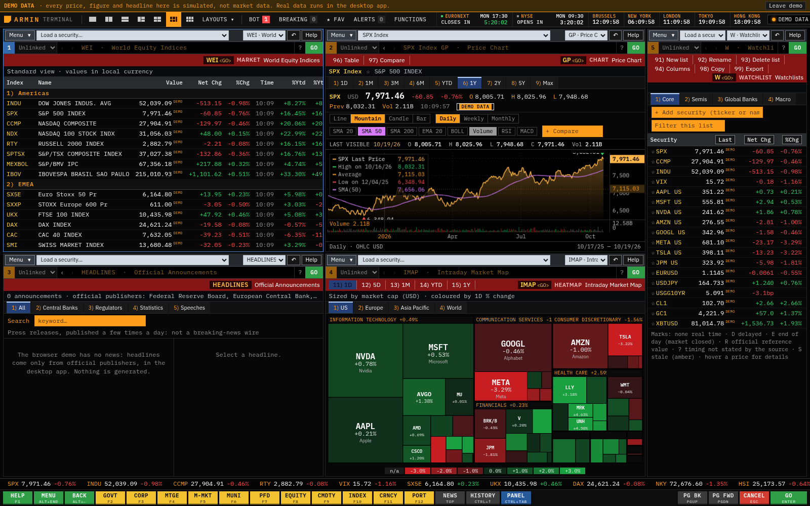

# Armin Terminal

Version **2.25.0** adds HOLDINGS (a company's 13F holdings) and CONGRESS (members of Congress's trades and holdings from their own disclosures), turns EVENTS into a weekly board of the most relevant earnings releases with revenue beside EPS everywhere, lets you build layouts of your own, and corrects estimates, beta and several descriptions after a review of the data sources. See the [2.25.0 release notes](docs/release-v2.25.0.md).

Version **2.24.0** adds workspace tabs like a browser's (Ctrl+T, Ctrl+W, rename, drag), brings back the US / Europe / Asia Pacific / World heat map beside a new heat map of each index's members, asks Yahoo for European stocks' analyst research, and fixes what a full audit of 2.23.0 found: NVIDIA's older EPS on the pre-split basis, a quarter shown as reported before it had ended, P/Es without their EPS, and commands from the reference guides that did not work. See the [2.24.0 release notes](docs/release-v2.24.0.md).

Version **2.23.0** corrects the figures an independent audit found wrong: short interest against the shares outstanding at each settlement, consensus multiples on today's shares with enterprise value only when debt and cash are known, London dividend yields (they read 100 times too high) and market cap history from the share counts filed before each day. It also fills European stocks' profiles, gives no buyback average price from rounded share counts, and shows every currency's daily change. 2.22.0 was not published on its own; its changes are included. See the [2.23.0 release notes](docs/release-v2.23.0.md).

Version **2.22.0** adds a market cap history for every US-listed stock (click any market value, or `MCAP AAPL`), opens the earnings calendar on today with a 500B+ tag for the largest companies, finds more supply-chain relations (competitors and stakes from the company's own report, joint ventures, names defined in filings), fixes Berkshire Hathaway's market value, and fills or explains most remaining blank fields. Windows only. See the [2.22.0 release notes](docs/release-v2.22.0.md).

Version **2.21.0** rebuilds the supply chain analysis (SPLC) for every stock. It reads other companies' quarterly reports, prospectuses and 8-K press releases beside their annual reports, plus the company's own press releases and agreements, and its classifier was checked against 27 companies in four rounds. A share counts only when a filing gives it to that company, and each relation shows who stated it and when, with partners, investors and lenders added. A company can now be found by its name ("coca cola SPLC"), and the mouse's back and forward buttons move through a panel's screens as in a browser. See the [2.21.0 release notes](docs/release-v2.21.0.md).

Version **2.20.0** answers the owner's feedback document: past quarters' expected revenue on EARNINGS and EVENTS (Finviz, Zacks or MarketBeat earnings histories, no key), a readable EVENTS calendar with accurate recent EPS, PROFILE's news box back, relevant peers (APLD: Cipher, Core Scientific, TeraWulf, IREN...), every executive's pay from the proxy statement, TipRanks-style rating actions with price-target changes, readable Equibles estimates, real-time bid and ask and a 1Y column on the watchlist, BREAKING only for stock-moving news, and a new TOPMOVERS screen with Yahoo Finance's most active, trending, gainers, losers and 52-week lists. See the [2.20.0 release notes](docs/release-v2.20.0.md).

Version **2.19.0** adds the supply chain analysis from the reference screen (SPLC: suppliers left, customers right, competitors below, each with the share of revenue the filings state, from SEC filings), group ranked returns (GRR), the buyback summary (BBK), the IPO calendar with first-day and since-offer returns (IPO) and full-text search of SEC filings (DS). See the [2.19.0 release notes](docs/release-v2.19.0.md).

Version **2.18.0** rebuilds the main screens on the owner's reference documentation: WEI, MOV, IMAP (a sunburst), MOST, FA, EARNINGS, DVD, HDS, EVTS, ECO and the alerts follow the reference layouts, and six functions are new: MEMB, MRR, EEO, CACS, SI and EQRP. Index monitors now cover the S&P 500, Nasdaq-100 and Dow's whole membership, ECO has every country's releases with consensus forecasts, and the APLD chart with IEX prices, GLCO's missing changes and the EVENTS freeze are fixed. See the [2.18.0 release notes](docs/release-v2.18.0.md).

Version **2.17.0** fills the screens that showed "--" when Yahoo Finance gave no data: PROFILE, HOLDERS, DIVIDENDS, ANALYSTS and EARNINGS take market value, ownership, short interest, price targets, ratings, EPS estimates, report dates and dividend dates from Nasdaq, FINRA and SEC EDGAR without a key. With `ALPHA_VANTAGE_API_KEY`, past quarters' expected revenue fills in too. Nasdaq requests (EVENTS' market calendar included) now answer, and the remaining SEC dates follow the DD/MM/YYYY setting. See the [2.17.0 release notes](docs/release-v2.17.0.md).

Version **2.16.0** covers the whole market's earnings on `EVENTS` (every US-listed company above $2B reporting in the window, with EPS and revenue expected and reported, the surprise and the growth, and an earnings card per report), fills reported quarters' revenue estimates on `EARNINGS`, lists every insider's Form 4 purchases, sales, awards and exercises on `MANAGEMENT`, shows dates as DD/MM/YYYY by default (SETTINGS), and lets watchlist lines be dragged into order. See the [2.16.0 release notes](docs/release-v2.16.0.md).

Version **2.12.0** brings a more compact terminal frame: gray panel controls with a working function selector, red action bars, blue active tabs and clearer quote fields. Charts show the inspected candle's date, OHLC and volume; historical price tags and study legends follow the visible data. Presentation follows Bloomberg's publicly documented screen conventions. See the [2.12.0 release notes](docs/release-v2.12.0.md) and [visual research and implementation](docs/visual-fidelity-v2.12.0.md).

All **2.11.0** features are included: the data-backed MESSAGES assistant with optional Claude, expected versus reported earnings, pre-market and after-hours watchlist columns, SEC proxy compensation, industry peers, formatted research reports, favourites and breaking news. See the [2.11.0 release notes](docs/release-v2.11.0.md). The independent panel toolbars, retained securities, contextual Help, hierarchical menus, command recall, configurable watchlist fields and brighter market timers from [2.10.0](docs/release-v2.10.0.md) are preserved; see the [watchlist guide](docs/watchlist-fields.md).

Everything in **2.9.0** is included: Belgian and other European markets (BEL 20, OMX Stockholm 30, ATX, PSI, ISEQ, Belgium on ECONSTATS, Nordic and Central European currencies), stocks on 15 European exchanges (`ABI BB`, `KBC.BR`), TipRanks analyst data on request, Bloomberg's beta defaults, bond day counts and settlement, WIRP columns as Bloomberg shows them, analyst figures and short interest on PROFILE and QUOTE, MANAGEMENT, splits and dividend growth, the price reaction to earnings, a portfolio in euros, and a complete heatmap without Yahoo's EU session. See the [2.9.0 notes](docs/release-v2.9.0.md) and [2.8.1 notes](docs/release-v2.8.1.md), the [Bloomberg workflow audit](docs/bloomberg-parity.md) and [calculator conventions](docs/calculators.md). The terminal now has 75 functions. IEX covers one exchange; indicative options are not real-time OPRA. Full Bloomberg feature and data parity remains incomplete.

After 2.12.0: long screens page like the terminal ("Page 2/5", PgUp/PgDn, a number then PgDn moves that many pages), monitor rows and news headlines are numbered and open with their number and GO, a mnemonic typed before F1 opens its help, autocomplete lists mnemonics, and `EXCH` shows exchange hours. New mnemonics: ERN, CF, NSE, EQRV, OWN, QR, HVG, PDF, GPO and GPC. See [terminal fidelity after 2.12.0](docs/terminal-fidelity-v2.13.md).

A keyboard-driven market terminal for private use, as a desktop app for Windows. You type a command such as `QUOTE AAPL`, `CHART NVDA 1D` or `MARKET US`, and up to six panels show quotes, charts, yields, central bank rates, economic statistics and company filings.

The desktop app uses public and official sources: the US Treasury, the Fed and other central banks, statistics offices, FRED, SEC EDGAR, Kraken, and Yahoo Finance for personal-use prices/company data. News comes from Google News and Yahoo Finance without a key; with your own keys it adds research (FMP, Finnhub recommendations and Equibles), news (Finnhub, Benzinga through Alpaca, Massive, Marketaux), IEX stocks and indicative option snapshots (Alpaca), plus sources for checking closes. Sources, timestamps, subscription refusals and missing coverage stay explicit. The browser build has no data source and opens a marked demo only when chosen.

This is an independent project, not affiliated with Bloomberg L.P. It does not have the data coverage of a professional terminal; [docs/feature-matrix.md](docs/feature-matrix.md) says what is covered and what is not.

## Download

From the [Releases page](https://github.com/arminshah/bloomberg-terminal/releases) (the repository is private; sign in first):

| System | File | |
| --- | --- | --- |
| Windows | `Armin-Terminal-Setup-<version>.exe` | Installs with Start menu and desktop shortcuts |
| Windows | `Armin-Terminal-<version>-Portable.exe` | Runs without installing |

The Windows files are not code-signed, so SmartScreen may warn on first launch (More info, then Run anyway). [docs/install.md](docs/install.md) has the details, running from source included.

## First start

Prices, charts, yields, central bank rates, official statistics, official announcements, market and company news, and crypto prices work at once, with no key. A few sources need a free key or your contact details; add them on the `PROVIDERS` screen, where they are encrypted with your system's key store and never shown again:

| Setting | Enables |
| --- | --- |
| `FRED_API_KEY` | US economic releases (`RELEASES`), the macro dashboard (`MACRO`), FRED's international series |
| `SEC_USER_AGENT` | SEC filings and reported figures (`FILINGS`): an application name and your own email, as the SEC requires |
| `COINGECKO_API_KEY` | Market value and supply of the listed coins |
| `MASSIVE_API_KEY`, `ALPHA_VANTAGE_API_KEY`, `TIINGO_API_KEY`, `TWELVE_DATA_API_KEY` | Second sources for US stock closes (`CROSSCHECK`); Massive also adds market and ticker news |
| `FMP_API_KEY` | Analyst price targets, ratings and estimates (`ANALYSTS`, `EARNINGS`) |
| `EQUIBLES_API_KEY` | Estimate report fallback, plus on-request guidance, KPIs, investor events, insider trades, short interest, 13F holders and IR news on `ANALYSTS` |
| `OPENFIGI_API_KEY` | Optional: faster ticker lookups for a company's 13F holdings (`HOLDINGS`); they work without it |
| `FINNHUB_API_KEY`, `MARKETAUX_API_TOKEN` | Market and company news (`MARKETNEWS`, `COMPANYNEWS`, `QUOTE`) |
| `ALPACA_API_KEY_ID`, `ALPACA_API_SECRET_KEY` | IEX stock quotes and indicative option contracts on `OPTIONS`, and Benzinga's news on the news screens; read-only market data, subject to account entitlement |

To add several at once, paste your whole list into "Save these keys" on `PROVIDERS`: it recognises each key, saves it encrypted and tells you which names it saved. Environment variables of the same names work too and take precedence. [docs/configuration.md](docs/configuration.md) covers every key and switch.

Finnhub also supplies company-profile/ratio fallbacks, monthly recommendation history, quarterly EPS comparisons and the next-report calendar. These use the REST key; the webhook signing secret is a different credential.

After upgrading, re-save the complete Finnhub REST API key on `PROVIDERS` if it was rejected: older builds could shorten valid 40-character keys. A shortened saved value cannot be reconstructed. Environment variables take precedence over saved keys.

For APLD research, `ANALYSTS` falls back to Yahoo targets, recommendations, rating actions and annual estimates when the primary providers cannot answer; `YAHOO_RESEARCH_ENABLED` controls this separately. If structured annual estimates are unavailable, one Equibles estimate report loads automatically. Other reports remain on request. **Research source availability** retains the exact provider failures; **Test research access** on `PROVIDERS` checks six datasets for the selected issuer. Coverage depends on source and issuer: quota does not unlock a denied endpoint. Equibles' shared 100/day allowance is unsuitable for polling stock prices.

`FILINGS` → **Reported figures** defaults to the currency with the latest monetary reporting period. Older currencies remain selectable with their coverage dates. Standalone quarters absent from SEC company facts are identified explicitly, with access to newer 6-K/8-K documents; they are not inferred from annual figures.

## Using the terminal

Type anywhere: the text goes to the active panel's command line, with suggestions as you type. A command is a function and a security, in either order, with optional arguments:

| Command | What it does |
| --- | --- |
| `QUOTE AAPL` | Quote for Apple |
| `ANALYSTS AAPL` | Analyst price targets, ratings and estimates (also `TARGETS AAPL`) |
| `MARKETNEWS NVDA` | Market news, filtered to Nvidia |
| `BREAKING` / `FIRST` | The last hour's news from every source, your favourites' stories and official announcements |
| `FAV` | Your starred securities with prices and news; ☆ beside any security's name stars it |
| `EARNINGS NBIS` | The last report against the analysts' expected EPS and revenue, and the next quarter's expectations |
| `MESSAGES` | Ask the help desk: "when does NVDA report?", "did APLD beat?", "SEC filings for TSLA" |
| `CHART NVDA` | Price chart; `CHART NVDA 1D` for today's intraday chart |
| `PROFILE MSFT` | Company profile |
| `FLDS AAPL` / `FIELDS AAPL PX_LAST` | Search current local fields and inspect value, units, definition, source, freshness and UTC time; copy/export filtered fields |
| `FILINGS MSFT` | SEC filings and the figures Microsoft reported |
| `WATCHLIST TECH` | The watchlist named Tech |
| `MARKET US` | World equity indices, Americas |
| `MACRO CPI` | The macro dashboard, on inflation |
| `CRYPTO BTC` | Bitcoin on the crypto monitor |
| `YAS` / `BONDCALC` | Bond price/yield, cash flows, DV01, benchmark G-spread and zero-curve Z-spread from explicit inputs |
| `AAPL OMON` / `OPTIONS AAPL` | Indicative listed equity option chain, provider IV/Greeks and source times with Alpaca keys |
| `AAPL OVME` / `OPTIONCALC AAPL` | European/American value or implied volatility from premium, exercise premium and CSV |
| `OSA` / `OPTIONSTRATEGY` | Multi-leg option/stock payoff, breakevens, aggregate Greeks and scenarios |
| `EURUSD FRD` / `FXFORWARD EURUSD` | Covered-interest-parity forwards and contract PV from your spot and term rates |
| `SWPM` / `SWAPCALC` | Fixed/float swap NPV, par coupon, cash flows and bump risk from your zero curves |
| `AAPL` | The functions menu for Apple |
| `SOFI`, `$APLD` | Any US-listed stock, looked up online if it is not built in |
| `3` | Pick item 3) on the current screen: a tab, an action, a monitor row or a headline |
| `13` then PgDn | Move 13 pages forward; the function bar shows `Page 2/5` |
| `GPC AAPL` / `GPO AAPL` | Candlestick or bar chart |
| `DES` then F1 | Help on the mnemonic typed |
| `CHART?` | Help on a function |

Enter runs a command, Esc clears the line, and Backspace on an empty line goes back a screen. F1 opens help for the current function; press it twice for the local help assistant. `HELP` opens the function directory. Menu (Alt+End) opens related functions, then moves up to the sector and main menus. Up/Down recalls this panel's commands when suggestions are closed; Ctrl+Up/Down also recalls with suggestions open. Alt+1 to Alt+6 select a panel, Ctrl+Tab cycles panels, and Alt+Left/Right moves through screen history. The loaded security stays visible in each panel toolbar, including on global market screens; choose another recent security from its dropdown. The buttons in the top bar switch between one and six panels, and the dividers between panels can be dragged; `LAYOUTS` saves and restores workspaces.

↻ REFRESH, at the right end of the top bar (Alt+R), asks every source the open screens and the background use for fresh data now, instead of waiting for each one's interval: quotes, news, announcements, fundamentals, earnings expectations, analyst research, rates and statistics. The arrow turns while they answer; then the button shows when the refresh finished, and its tooltip lists what was asked, what failed and what was left alone. Sources with a daily allowance keep answers younger than an hour, so clicking again and again does not use it up ([limits](docs/limits.md#the-refresh-button)). A story about one of your favourites pops up and stays until you close it (×) or click it, which opens the story at its publisher (the ticker opens `COMPANYNEWS`); pop-ups not dismissed survive a restart, ★ in the top bar counts them and `BREAKING FAV` lists them. SETTINGS "Pop up flash headlines" turns pop-ups off.

The top bar starts with two compact market timers, Euronext then NYSE. Each shows the exchange, the scheduled weekday/time in that exchange's local time, and an aligned OPENS IN/CLOSES IN countdown. They cover the regular session (09:00 to 17:30 Brussels time, 09:30 to 16:00 New York time), follow holidays and early closes, and open the exchange calendar when clicked. Open sessions have a green marker and countdown. Clocks for Brussels, New York, London, Tokyo and Hong Kong follow, with orange city names above aligned white local times. Exchange names use the same original orange.

Command names changed in version 2.0.0. Mnemonic commands such as `GP` and `DES` are supported as aliases for the corresponding implemented functions; saved layouts and settings carry over.

## Functions

| Area | Functions |
| --- | --- |
| Equity | `PROFILE` description and key figures, `FINANCIALS` statements and ratios, `FUNDCHART` fundamentals over time, `EARNINGS` reported results against the analysts' expectations, `DIVIDENDS`, `HOLDERS`, `MANAGEMENT` officers and executive pay from proxy statements, `PEERS` relative valuation against companies in the same industry, `EVENTS` earnings (with expected EPS and revenue) and dividend calendar, `FILINGS` SEC filings and reported figures, `CROSSCHECK` closes against other sources, `WACC` cost of capital, `ANALYSTS` price targets, ratings and estimates |
| Charts | `CHART` with studies and comparisons, `INTRADAY`, `HISTORY`, `RETURNS`, `TOTALRETURN`, `SPREAD`, `BETA`, `VOLATILITY` |
| Markets | `MARKET` world indices, `EXCHANGES` (`EXCH`) exchange hours and status, `INDEXFUTURES`, `CONTRIB` index movers, `HEATMAP`, `MOVERS`, `SCREEN` stock screener, `QUOTE`, `TRADES`, `DEPTH` (order book for crypto, best bid and offer otherwise), `VWAP` |
| News | `BREAKING` (`FIRST`) the newest stories from every source with pop-ups for your favourites, `MARKETNEWS` (`TOP`) market and merger news, the latest 8-K filings and Euronext press releases, `COMPANYNEWS` any security's news, from the local press in its market's languages and, for a stock listed there, its Euronext press releases; `NEWS` searches every story; `HEADLINES` press releases and speeches from central banks, the BIS, BEA, ESMA and SEC |
| FX and crypto | `FXMATRIX` cross rates, `FXRANK`, `CRYPTO`, `FXOPTION` European option pricer with overrides, `FXFORWARD` calculated forwards and contract PV from your term rates |
| Rates | `BONDS` world government yields, `CURVE`, `MONEYMARKET`, `RATEPROBS` the Fed path priced in futures, `CENTRALBANKS`; `BONDCALC` contract analytics and `SWAPCALC` from user zero curves; `BONDSEARCH`, `DEBTPROFILE` and `DEALERQUOTES` still need bond/dealer datasets |
| Commodities | `COMMODITIES` |
| Economics | `MACRO` dashboard with first-release revisions, `RELEASES` calendar, `ECONSTATS` world statistics, `HOLIDAYS` exchange calendars |
| Derivatives | `OPTIONS` indicative listed US equity snapshots with Alpaca; `OPTIONCALC` European/American value/IV; `OPTIONSTRATEGY` common-expiry multi-leg/stock risk and scenarios |
| Portfolio and tools | `WATCHLIST` with pre-market and after-hours prices, `FAVOURITES` (`FAV`), `PORTFOLIO` manual holdings, historical-FX replay, VaR/ES, risk contributions and price/FX stress, `ALERTS`, `CORRELATION`, `SEARCH`, `RECENT`, `NOTES`, `LAYOUTS` |
| System | `HELP`, `MENU`, `PROVIDERS` data providers and keys, `SETTINGS`, `MESSAGES` help desk that answers questions from the app's data (Claude with your Anthropic key) |

Tables can be copied or exported as CSV. Watchlists, the portfolio, alerts, notes, layouts and settings are kept on your computer. Paper trading is switched off: the portfolio holds only what you enter.

## Where the data comes from

| Data | Source | Freshness |
| --- | --- | --- |
| Stock, index, futures, currency and commodity prices; daily and intraday history; company profiles, statements, holders and dividends | Yahoo Finance (personal use) | Real time or delayed by exchange, as Yahoo labels each quote; history end of day |
| Crypto prices, best bid and offer, candles and order books (10 USD pairs) | Kraken; Yahoo Finance for the session if Kraken does not answer | Real time as of each snapshot |
| Crypto market value and supply | CoinGecko (key) | Aggregated, every 10 minutes |
| US Treasury yields, every tenor | US Treasury | End of day; the Cboe 5, 10 and 30-year indices intraday |
| Fed funds, SOFR and the other reference rates; FOMC dates | New York Fed, Federal Reserve Board | Daily |
| Policy rates | ECB, Bank of England, Bank of Canada, RBA, SNB, Banco Central do Brasil | As decided |
| Government yields | Bundesbank, Bank of England, Ministry of Finance Japan, Bank of Canada, RBA | End of day |
| Economic statistics | ONS, Eurostat, Statistics Canada, ABS; FRED (key) for US releases and other countries | As published |
| Filings and reported financial figures | SEC EDGAR (your contact) | As filed |
| Press releases and speeches | Central banks, BIS, BEA, ESMA, SEC (RSS) | As published |
| Analysts' expected EPS and revenue against the reports; similar stocks | Yahoo Finance research; Finnhub (key) for past revenue estimates and sub-industry peers | Kept 6 hours, hourly after a report |
| Executive pay | SEC EDGAR proxy statements (your contact) | As filed |
| Analyst price targets, ratings, rating actions, annual estimates | Financial Modeling Prep (key) | As of each answer, kept 6 to 24 hours |
| Market and company news | Finnhub, Alpaca (Benzinga), Massive and Marketaux (keys), Google News, Yahoo Finance headlines, Euronext, SEC EDGAR 8-K filings; MarketWatch if you switch it on | As each publisher posts |
| Help desk answers (optional) | Anthropic Claude (key), reading the sources above | As of each question |
| IEX last trade, bid and offer for US stocks | Alpaca (keys) | Real time, IEX only (one exchange) |

Each price shows one of these labels: REAL-TIME, DELAYED, END OF DAY, REFERENCE (an official value published once a day), STALE, UNKNOWN FRESHNESS, or DEMO DATA in the browser demo. Hover a price for the reason, the source's own time and the time it arrived. A day's change is shown only against a previous close confirmed for the right session.

Some figures are calculated from the real data, and the screens say so: the Fed path on `RATEPROBS` (the CME FedWatch method on fed funds futures), index futures' fair value, year-on-year rates from published index levels, option values on `OPTIONCALC`, and returns, volatility, beta and correlation.

[docs/data-providers.md](docs/data-providers.md) gives each provider's terms and limits with the pages they come from.

## Documentation

- [Installing and starting](docs/install.md), on Windows
- [Configuration](docs/configuration.md): keys, switches and the provider screen
- [Data providers](docs/data-providers.md), [limits and entitlements](docs/limits.md) and [attribution](docs/attribution.md)
- [Feature and data coverage](docs/feature-matrix.md): what is implemented, with what data, and what is missing
- [Data dictionary](docs/data-dictionary.md): fields, freshness labels and formulas
- [Architecture](docs/architecture.md), [testing](docs/testing.md), [adding a provider](docs/adding-a-provider.md) and [troubleshooting](docs/troubleshooting.md)
- [Roadmap](docs/roadmap.md): what changed in each version and what comes next

## Development

Use Node.js 24, as used by CI. Node.js 22 can also run the project.

| Command | Purpose |
| --- | --- |
| `npm run desktop` | Build and start the desktop app |
| `npm run dev` | Browser build with hot reload (no data; demo on request) |
| `npm run lint`, `npm run typecheck` | ESLint and the TypeScript build |
| `npm test` | Unit tests (Vitest) |
| `npm run e2e` | Browser tests (Playwright) |
| `npm run desktop:build` | Windows installer and portable app in `release/` |
| `npm run desktop:build:portable` | Windows portable app in `release/`, on any system (no Wine needed) |

The code is split into `electron/` (the main process, which makes every provider request and keeps the keys), `src/data/` (the engine, the provider registry and one module per source under `live/`), `src/finance/` (bond, option and statistics math), `src/terminal/` (command parser, function registry, panels and settings), `src/components/` and `src/functions/` (one file per screen or group of screens).

## Disclaimer

Armin Terminal is an independent project for private use and is not affiliated with Bloomberg L.P.; Bloomberg is a trademark of Bloomberg Finance L.P. The data it shows belongs to its providers and is for your own use only, not for redistribution. Free data has delays, gaps and errors, and calculated figures are models with stated assumptions. Nothing here is investment advice.
