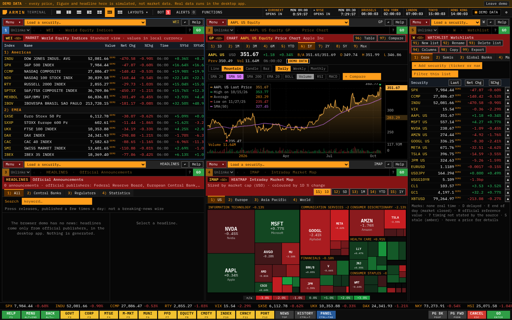
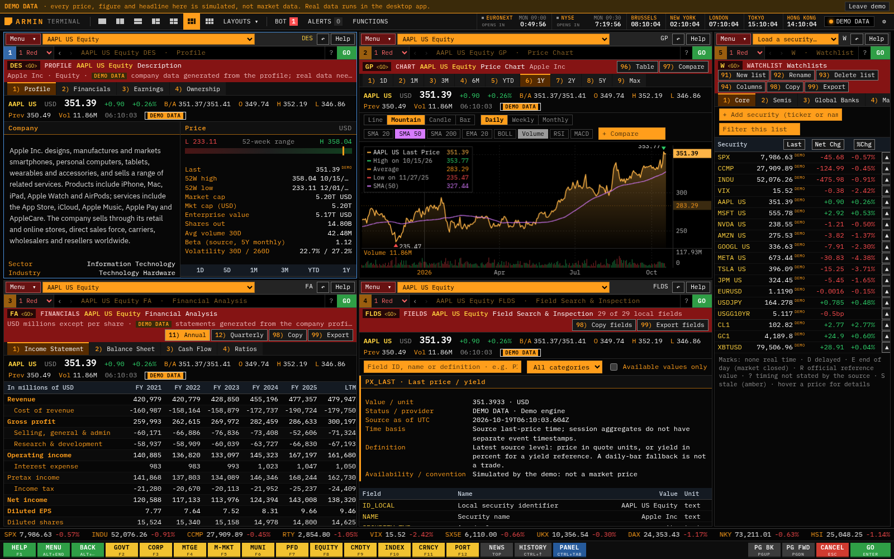

# Terminal fidelity source update

This update starts from the v2.9.0 release and includes the subsequent news-provider work on `claude/data-sources`. It improves the shared terminal and everyday analysis workflows. The [research audit](terminal-fidelity-audit.md) records the primary references, the 72-function inventory, missing capabilities and their dependencies. These changes are not a published release or a claim of exact Bloomberg parity.

## Implemented

- Independent panel toolbars with a recent-security dropdown, retained loaded security, active function mnemonic, command recall and contextual help.
- Persistent security context across market screens, sector menus and help, including after the 50-screen history limit and workspace reload. Older workspaces migrate without a schema reset.
- Menu moves from the security menu to its sector and Main Menu; Back remains separate screen-history navigation. Breadcrumbs and numbered News & Research / Portfolio & Tools paths make discovery consistent.
- F1 opens help for the current function; a second press opens the explicitly local assistant. Help examples retain compatible securities and choose a bond for bond-only functions.
- Per-panel command recall with draft restoration, keyboard-accessible autocomplete and consistent GO handling for Enter, inline GO and the footer key.
- All F2–F12 sector buttons, a blue PANEL key, Ctrl+Tab panel cycling and Alt+End Menu. GO and CANCEL stay visible when the other keys scroll on narrow windows.
- Red function bars, amber editable fields, outlined action controls and blue active-panel/focus cues. Shared headers wrap and scroll actions in narrow panels.
- Saved per-watchlist field selection/order, presets, sorting, filtering and exports that follow the displayed selection. CSV retains raw units and per-field sources, times and missing-data reasons. Date-only values retain their calendar date. See [watchlist fields](watchlist-fields.md).

## Review images

Both images use the visibly labelled simulated browser demo. They demonstrate presentation, not live data availability.

## Verification

Completed local verification on 19 October 2026:

| Check | Result |
| --- | --- |
| ESLint and TypeScript | Pass |
| Production Vite build | Pass |
| Unit suite | 689 tests across 52 files pass |
| Chromium browser workflows | 27 pass, including rendering every registered function |
| Linux Electron workflows | 22 pass through the real desktop renderer and IPC boundary |
| Visual inspection | 1600×1000, 1280×800 and 390×800; no page horizontal overflow at the two narrower sizes and footer GO remains visible |

The desktop suite uses synthetic provider responses and disposable profiles. It establishes application behavior, not live entitlement or native Windows installation. Browser and desktop runs were completed separately so a browser build could not remove files while Electron was launching.

No licensed Bloomberg session or owner provider credentials were available for a side-by-side data comparison. Bloomberg reporting, exchange entitlements, economic consensus, dealer quotes, messaging counterparties, execution and spreadsheet services remain separate gaps. The audit distinguishes connected data, local models and unavailable workflows; a mnemonic alias does not establish service equivalence. Existing released installers are unchanged by this source update.
