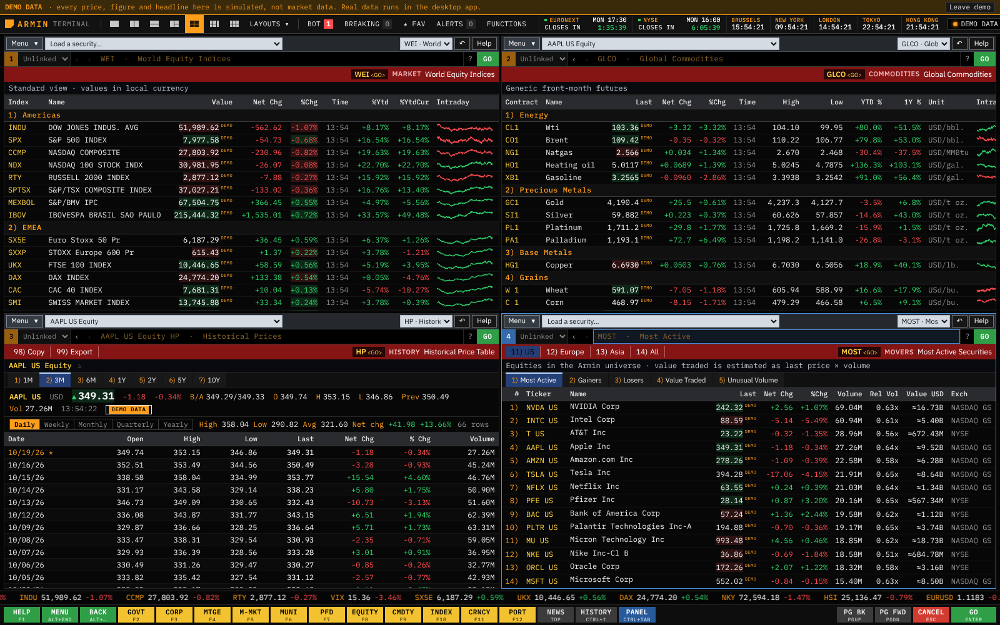
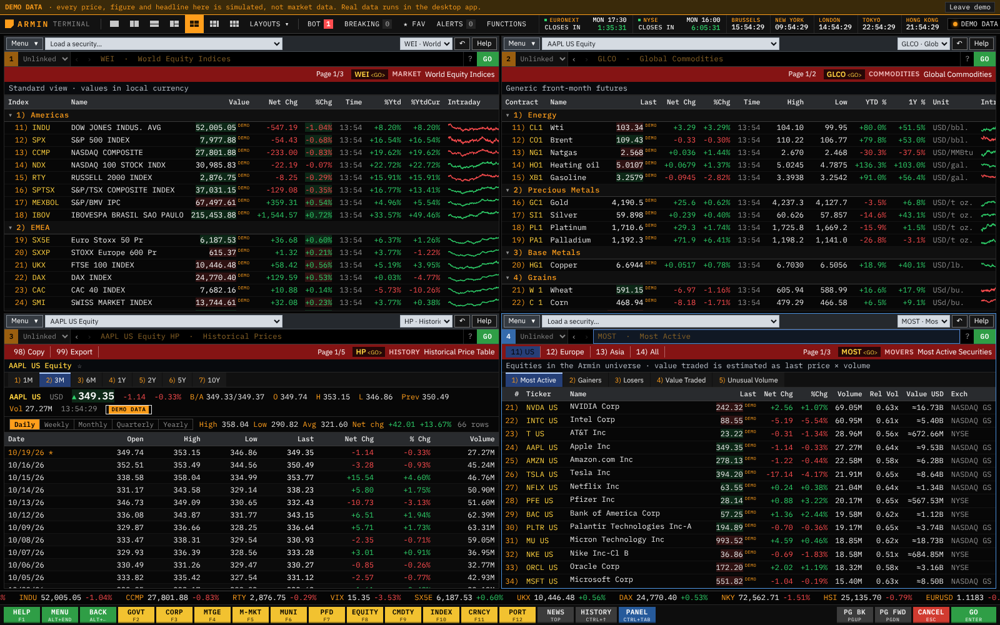

# Terminal fidelity, after 2.12.0

Reviewed 19 October 2026 against the 2.12.0 build (commit `9a6f360`) in the browser demo and the Linux desktop app, and against Bloomberg's public material: the getting-started guide and keyboard guides that university libraries host (Illinois, Tampa, Kent, Northwestern), and the sources already listed in [the fidelity audit](terminal-fidelity-audit.md) and [the 2.12.0 visual notes](visual-fidelity-v2.12.0.md). No licensed Bloomberg session was available, so this compares conventions and workflows, not pixels or data.

## What was compared

Every main screen was opened at 1600×1000, 1280×800, in four and six panels and on a phone width, and compared with how the terminal is documented to work: the command line and yellow keys, numbered items with GO, PAGE FWD / PAGE BACK, HELP, autocomplete, the panel and function-bar chrome, and the layouts of DES, GP/GIP, HP, FA, EE, ANR, CN/TOP/N, WEI, MOST, GLCO, WB, BTMM, OMON, ECO, WIRP, HDS, RV and W.

## Differences found, most noticeable first

1. Long screens did not page. PgUp/PgDn scrolled by 90% of the panel with no page count; the terminal shows "Page 2/5" on the function bar and a number typed before PAGE FWD moves that many pages (the keyboard guides give "13 PAGE FWD" for page 2 to page 15). Scrolled tables also lost their column names under the pinned function bar.
2. Rows on monitors and news lists were not numbered, or were numbered without doing anything. On the terminal, "12) S&P 500" or a headline's number is typed with GO to open it. MOST numbered its rows 1) to 40), the same numbers as its own tabs, and typing them changed the tab instead.
3. HELP ignored what was typed. "DES <HELP>" opens DES's help on the terminal; here F1 always opened the current screen's help.
4. Autocomplete listed descriptive names (PROFILE, CHART) where the terminal lists mnemonics (DES, GP).
5. Everyday mnemonics were missing for screens the app already has: ERN, CF, NSE, EQRV, OWN, QR, HVG, PDF, and GPO/GPC for bar and candlestick charts. EXCH, the exchange hours screen, had no equivalent although the app keeps the calendars.
6. `CHART AAPL 1D` showed ten years of daily bars with the 1D tab lit; the README and the INTRADAY example say it opens today's intraday chart. `HP AAPL 1Y` ignored its range.
7. In narrow panels an empty strip remained where the hidden subtitle had been.

## What changed

- **Paging** on every screen: "Page n/m" on the function bar, PgUp/PgDn and the PG BK / PG FWD keys move whole pages, a typed number moves that many, clicking the page count shows the next page, and table headings stay below the function bar on every page (`src/terminal/paging.ts`, `src/components/PageIndicator.tsx`).
- **Numbered rows and headlines**, typed with GO to open them as a click would: WEI and WEIF from 11) with region headings 1) to 3) that collapse and expand, GLCO from 11) with groups 1) to 6), CRYP, WB (a country opens its 10-year yield chart), MOST from 21), EQS, and the headlines on TOP, CN, N, BREAKING, FAV and HEADLINES. Numbers skip 96 to 99, which belong to the function bar (`src/terminal/numbering.ts`).
- **HELP on typed text**: a mnemonic typed before F1 opens its help page; words search the help.
- **Autocomplete** shows mnemonics when the mnemonic display setting is on, with the descriptive name on hover.
- **Mnemonics**: ERN (EARNINGS), CF (FILINGS, accepted when typed but not shown as the screen's name, since FILINGS reads SEC EDGAR only), NSE (NEWS), EQRV (PEERS), OWN (HOLDERS), QR (TRADES), HVG (VOLATILITY), PDF (SETTINGS). GPO and GPC open CHART as OHLC bars or candlesticks for that chart only and show under their own mnemonic.
- **New function `EXCH` (EXCHANGES)**: NYSE, Euronext, London, Xetra and Tokyo with local time, OPEN / CLOSED / HOLIDAY / WEEKEND, today's holiday or early close, the next open or close with a countdown, and whether the published holiday table still covers it. It uses the same published rules and tables as HOLIDAYS and the top-bar timers; a row number opens that exchange's calendar.
- **Fixes**: `CHART X 1D` opens the intraday chart; `HP X 1Y W` takes a range and periodicity; the empty subtitle strip is hidden in narrow panels.

Both images are the labelled browser demo; they show presentation, not data.

## What remains different, and why

- **Data and services**: consolidated real-time quotes and depth, Bloomberg News and research, consensus estimates, economic surveys, dealer and bond data, messaging, execution and the Excel/API services need licensed or contributed data and counterparties. The screens keep saying so; nothing is simulated in the desktop app.
- **Fonts and exact colours**: Bloomberg's typefaces and palette are proprietary and not published; the app keeps IBM Plex and its own approximations, and no Bloomberg logos or assets.
- **Panel chrome**: the order of the security toolbar, command line and red bar follows the 2.12.0 reading of the getting-started guide; without a licensed session, its exact current arrangement could not be checked, so it was left as it was.
- **Numbering scheme**: where Bloomberg's exact row numbers for a screen are not documented, rows start after the screen's own tab and action numbers (1, 11 or 21).
- **CF, CACS, RELS, IPO, BI, MSG** and similar functions whose scope is wider than any free source are not added under those names, or (CF) are accepted without claiming the wider scope.
- **Top bar**: its right-hand buttons and the breaking-news pop-ups were left alone for a parallel change.

## Verification

ESLint and TypeScript pass. Unit tests: 775 across 60 files. Chromium browser workflows: 31, including every registered function, numbered rows, paging and the chart and help shortcuts. Linux Electron workflows: 23, including typed headline numbers on company news through the real IPC boundary with synthetic provider answers.
