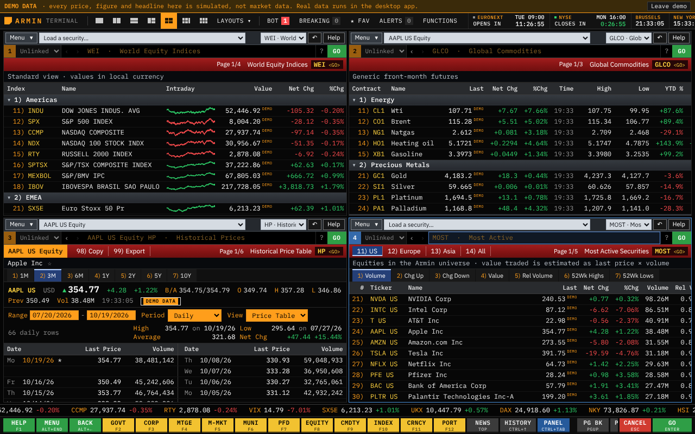
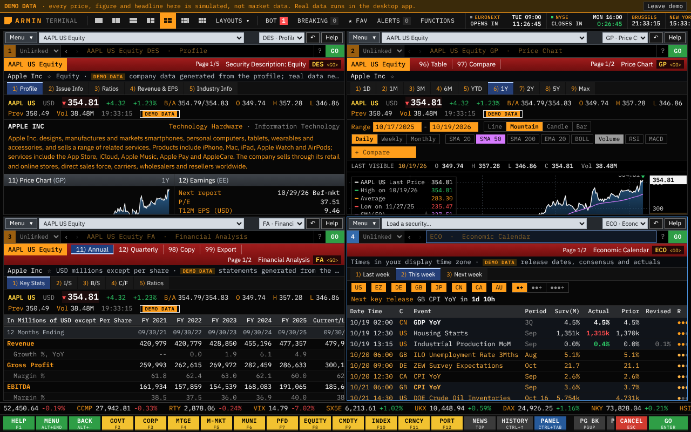

# Terminal fidelity, after 2.13.0

Reviewed 19 October 2026 against the 2.13.0 build (commit `522470a`) in the browser demo and the Linux desktop app, and against screenshots of the real terminal in a university Bloomberg training booklet (DES and its Ratios and Revenue & EPS pages, GP, HP, ERN, DVD, OWN, ANR, RV, WEI, MOST, EQS, TOP, NSE, EVTS, ECO, ECFC, ECMX, ECST, WB, BTMM, FOMC, GLCO, FXC and the sector menus), plus the sources in [the 2.13 notes](terminal-fidelity-v2.13.md). No licensed session was available, so this compares layout, labels and workflow, not data or pixels.

## Differences found, most noticeable first

1. The red function bar did not read as the terminal's: the security sat on a separate line, the right end showed "DES <GO> PROFILE Description", and a chosen view in the bar (11) Annual) was black on dark blue.
2. GP drew an amber line and fill; the terminal's default is a white price line over a blue mountain with the last value tagged in white, and amber start/end date boxes above the chart.
3. DES had its own tabs (Profile, Financials, Earnings, Ownership) and free-form sections; the terminal has 1) Profile 2) Issue Info 3) Ratios 4) Revenue & EPS 5) Industry Info, the name in capitals, an amber description and numbered boxes that open functions (Price Chart (GP), Earn (ERN), Dividend (DVD), Management (MGMT), 12M Total Ret (TRA), Beta).
4. HP showed an OHLC table; the terminal's HP is a price table of weekday-dated last prices and volume in blocks across the screen, weeks apart, with Range/Period fields and the range's high and low with dates.
5. Monitors numbered rows straight on (WEI 11) to 50), renumbering when a region folded); the terminal starts each region on its own ten (11), 21), 31)). WB had no regions.
6. Headline lists put the time first; the terminal shows "1) Headline ... BN 10:15".
7. ERN's columns (Reported, Comp, Estimate, %Surp, %Px Chg) and its snapshot, ANR's summary block, ECO's agenda (Date Time on each line, upcoming releases in amber), FA's page names (Key Stats, I/S, B/S, C/F, Ratios) and "12 Months Ending" line, and the menus' white mnemonics with amber names were missing.
8. Section headings and group lines were amber text; the terminal uses grey strips with white titles. Key-value lists began with an empty line, clipped names sat above their row, and in narrow panels the red bar took three lines.

## What changed

- **Function bar**: amber security field at the left, numbered actions, then page count, title and mnemonic at the right; readable chosen views; the company name on the line below. In narrow panels the security and title share one line.
- **GP/GIP**: white line, blue mountain, white last-price tag, visible dotted grid; amber Range boxes take typed dates (a period tab clears them). The DES and BQ charts use the same style.
- **DES (equity)**: the five terminal pages. Profile has numbered boxes 11) to 21) and related functions from 41). Ratios are worked out from the reported statements and say so; missing inputs show "--".
- **HP**: Price Table (default) and OHLC Table views, Range, Period and View fields, High/Low with dates, Average, Net Chg. `HP AAPL OHLC` opens the OHLC view.
- **WEI, WEIF, GLCO, WB**: region numbering by tens; WB grouped by region; WEI's intraday line beside the name; narrow panels hide name and line so the changes stay in view.
- **News**: number, amber headline, source code and time. Source codes are this app's abbreviations of publisher names, with the full name on hover; they are not Bloomberg wire codes.
- **EE/ERN**: Earnings/Surprise Snapshot and an Earnings History & Price Reaction table with Comp, Estimate and %Surp where the desktop app's sources compare them.
- **ANR**: titled Analyst Recommendations, with a summary of a 1-to-5 rating score worked out from the counts, shares of buys/holds/sells, average target, return potential and LTM return.
- **ECO**: agenda layout, Surv(M), alternating day shading, upcoming releases in amber. **FA**: Key Stats (with growth and margins), I/S, B/S, C/F, Ratios; `FA AAPL BS` opens a page. **MENU**: white mnemonics, amber names, blue breadcrumb. **MOST**: Volume, Chg Up, Chg Down, Value, Rel Volume, 52Wk Highs, 52Wk Lows. **HDS**: the terminal's column order. **RV**: peer average and median above the rows.

## New functions and aliases

- `FOMC` (`FEDMEETINGS`): the year's FOMC announcement days from the Federal Reserve Board's calendar, with the target range that took effect and the move, from the New York Fed's series; related functions 21) to 25).
- `RSI`, `MACD`, `BOLL`: a chart with that study added for that chart only.
- `EVT` (EVENTS) and `ECMX` (ECONSTATS).

Both images are the labelled browser demo. The 2.13 state is in [terminal-v2.13-after.png](terminal-v2.13-after.png).

## What remains different, and why

- **Top bar width**: at 1280 to 1600 px the right end of the top bar (settings and, in the desktop app, REFRESH) scrolls out of view; the clock fold widths need adjusting. Left for the next round.
- **Data**: Bloomberg estimates (BEst), contributor research, news, dealer and option data, ERN's guidance and implied move, ANR's broker list with BARR and rank, OWN's matrix and transactions, and historical market capitalisation on FA Key Stats need licensed or contributed data. Screens leave them out or say so.
- **Layout not reproduced**: EVTS's weekly grid, MOST's news column, GP's Track/Annotate/News tools and chart templates, DES's FIGI and depositary receipts, ECO's alert and A/M/R icons, WB's bid/ask and range bars.
- **Fonts and colours** remain approximations; no Bloomberg logos or assets are used.

## Verification

ESLint and TypeScript pass. Unit tests: 816 across 64 files. Chromium browser workflows: 32. Linux Electron workflows: 25.
