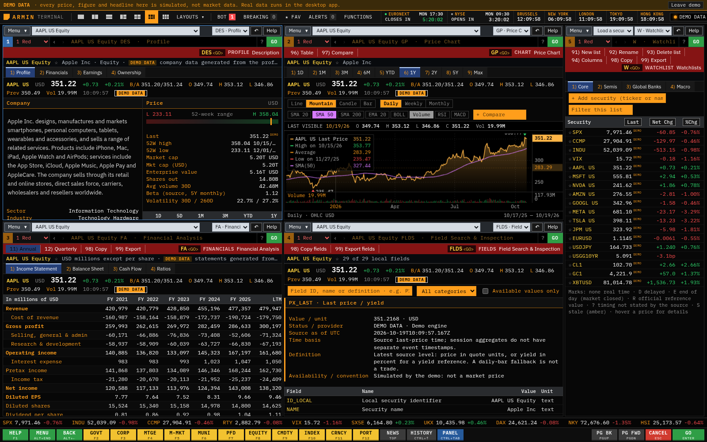

# Visual fidelity research for 2.12.0

Reviewed **19 October 2026** against Bloomberg-authored public material. This pass concentrates on the function frame, typography, quote layout and chart controls. It complements the broader [feature audit](terminal-fidelity-audit.md); it does not establish parity with a running, licensed Terminal.

## What the references actually show

| Source | Directly observed or documented | Consequence for this app |
| --- | --- | --- |
| [Getting Started Guide](https://data.bloomberglp.com/professional/sites/10/Getting-Started-Guide-for-Students-English.pdf), printed pp. 12–14 | A gray toolbar holds security and function selectors; the command line has a blue focus treatment. Menu selection is blue. The function's red bar contains action menus at the left and its title at the right. Editable fields inside functions are amber. Tables and section headings use gray strips. Numbered links support keyboard navigation. | Give the security/function controls their own compact toolbar, make the function selector work, and reserve the red bar for actual function actions. Distinguish command focus from amber data-entry fields. |
| [Terminal Essentials: Getting started](https://professional.content.cirrus.bloomberg.com/professional2023/insights/technology/bloomberg-terminal-essentials-getting-started/), **13 October 2024** | The chapter list explicitly covers window anatomy, loading a security, menus/mnemonics and help. Its [official poster](https://assets.bbhub.io/professional/sites/41/Terminal-Essentials_Getting-started-with-the-Terminal_1200x800.png) shows tightly stacked charts, compact gray range controls, blue selected ranges, white price lines and green/red change bars. | Keep chart controls in narrow horizontal rows and make the selected range visible. Preserve a useful plot area when charts share a workspace. |
| [Terminal Essentials: Best equities functions](https://professional.content.cirrus.bloomberg.com/professional2023/insights/technology/bloomberg-terminal-essentials-best-equities-functions/), **10 October 2024** | The published outline separates overview, screening, relative valuation, fundamentals, estimates and recommendations. Its [official poster](https://assets.bbhub.io/professional/sites/41/Terminal-Essentials_Equities-functions-on-the-Terminal_1200x800.png) shows amber security text alongside white labels, green price data, thin axes and a white line over a change histogram. | Treat quote, chart and company-analysis screens as distinct working views with consistent controls, rather than decorating each with the same oversized header. |
| [Bloomberg Charts](https://professional.bloomberg.com/products/bloomberg-terminal/charts/), current product page, accessed **19 October 2026** | The page describes multi-instrument comparisons, chart templates, annotation-preserving exports, studies and collaborative charts. This is a capability description, not a pixel specification. | Keep comparison, study and chart/table workflows discoverable. An OHLC readout must describe the selected bar, and a pan operation must retain its historical position as data updates. Those correctness requirements are our engineering interpretation. |
| [Bloomberg Japan: designing for color accessibility](https://www.bloomberg.co.jp/company/stories/designing-the-terminal-for-color-accessibility/), **6 April 2022** | The article explains the default red/green market colors, amber information, and alternate accessible schemes. Its [default Launchpad image](https://assets.bbhub.io/company/sites/51/2021/10/CVD-3-a.png) shows compact tiled charts, tables and heat maps on black, with restrained separators. | Preserve strong contrast and signed numbers. Readability remains part of fidelity; an inaccessible dark label is not an authenticity requirement. |

## Interpretation and implementation boundaries

The references use varying-width labels and compact numerals; they do not support the common imitation of using a large monospaced font everywhere. Using a system sans-serif face for interface labels and tabular numerals for figures is a local approximation. The public material does not establish an exact font family, point size, RGB palette or spacing system. CSS choices in this release must be described as approximations.

The visual priorities are a usable security/function toolbar, a separate red action strip, compact gray table headings, an active blue selection, a prominent sourced quote with session details, and a chart that exposes the data under the cursor. Chart interaction and quote-session values must remain accurate while making these views denser. Session prices need their source times and the appropriate regular-close comparison; unavailable figures remain unavailable.

The guide PDF's metadata dates it to **3 November 2017**, and its screenshots include older dates. It is evidence of established conventions, not proof that every 2026 function looks the same. Printed p. 14 is **Equity Screening**, not a security-description screen. The 2024 tutorial posters contain historical market charts; their publication date is not the date of the displayed prices.

The poster images were inspected, but the tutorial videos were not played or analyzed frame by frame. The current Charts page text was read; its embedded image links could not be opened through the web reader. No exact-match claim depends on those unseen images. Research downloads stay outside the repository; this document links to the originals.

No Bloomberg fonts, logos, software assets or market datasets are added by this work. Public references cannot recreate licensed data, contributor coverage, messaging, execution or spreadsheet services; those remaining service gaps are covered in the existing feature audit.

## Implemented screens

These captures show this app in its explicitly labelled simulated-data mode.

